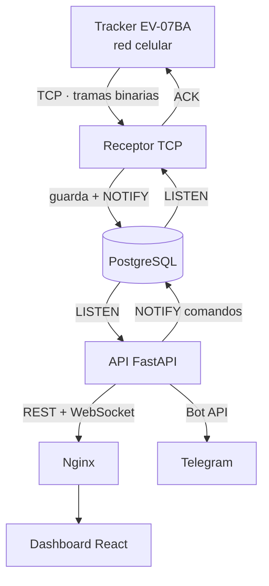

# Smart Tracker SOS · Monitoreo de trackers GPS en tiempo real

Plataforma de monitoreo para trackers GPS con botón SOS · FastAPI · React · Leaflet ·
PostgreSQL · WebSocket · Docker

Proyecto individual · Laboratorio de Prácticas Profesionalizantes III · ISFT N° 177 · 2026

El código fuente está en un repositorio privado. Disponible para revisión.

---

## Qué problema resuelve
El tracker EV-07BA es un dispositivo con GPS, botón de pánico y conexión celular,
pero por sí solo no sirve para nada: no habla HTTP ni tiene interfaz. Abre una
conexión TCP y envía **tramas binarias** en un protocolo propietario.

Este sistema es el otro extremo de esa conexión: recibe las tramas, las decodifica,
las guarda y las muestra en un dashboard web que se actualiza solo. Cuando alguien
aprieta el botón SOS, el aviso llega al instante al dashboard y por Telegram.

## Qué desarrollé
Proyecto individual: diseñé y desarrollé el sistema completo, del protocolo al frontend.

**Receptor TCP y protocolo binario**
- Implementé el **códec del protocolo binario Eview**, el único lenguaje que
  habla el tracker: lectura y armado de tramas, verificación de integridad con
  **CRC-16/XMODEM** y respuesta ACK a cada mensaje.
- El receptor **se resincroniza** si llegan datos corruptos: descarta bytes
  hasta el siguiente encabezado válido en lugar de cortar la conexión.
- Decodificación de posiciones GPS, estado general (batería, señal) y alarmas.
- Herramientas propias para depurar: un **simulador** de tracker y un
  **sniffer** de tramas crudas.

**API (FastAPI)**
- 28 endpoints REST: autenticación, usuarios, dispositivos, posiciones,
  historial, alertas, auditoría y estado del sistema.
- Autenticación **JWT**, contraseñas con **bcrypt** y permisos por rol
  (administrador, supervisor, operador, invitado).
- **WebSocket** que transmite en vivo posiciones y alertas, filtradas por los
  dispositivos que cada usuario tiene permitido ver.
- Ingesta alternativa de posiciones por REST con **API key** (`X-API-Key`).
- Alertas por **Telegram** al responsable del dispositivo y a los supervisores.
- Registro de auditoría de las acciones de los usuarios.

**Dashboard (React)**
- SPA con **React 18 + Vite** y React Router: dashboard, historial, alertas,
  dispositivos, usuarios y auditoría.
- Mapas con **Leaflet**: última posición de cada equipo y recorrido histórico
  con filtros por fecha.
- Conexión en tiempo real con **reconexión automática** y heartbeat: si se corta,
  vuelve a conectarse sola.
- Servido por **Nginx**, que además funciona como proxy hacia la API.

**Infraestructura y calidad**
- Cuatro servicios orquestados con **Docker Compose**: PostgreSQL con
  healthcheck, API, receptor TCP y frontend.
- **22 tests con pytest** del códec del protocolo, con tramas capturadas del
  dispositivo real.

## Stack
**Backend:** Python 3.12 · FastAPI · SQLAlchemy 2.0 · PostgreSQL 16 · Pydantic 2 ·
PyJWT · bcrypt · httpx · WebSockets · pytest

**Frontend:** React 18 · Vite · React Router · Leaflet / React-Leaflet

**Infraestructura:** Docker Compose · Nginx · Telegram Bot API

## Arquitectura

## Decisiones técnicas
- **PostgreSQL como base y como bus de mensajes.** El receptor y la API se
  comunican con `LISTEN/NOTIFY`, sin sumar Redis ni RabbitMQ.
- **Comandos por el canal inverso.** El servidor no puede iniciar contacto con el
  tracker; los pedidos como "localizar ahora" viajan por la conexión TCP que el
  propio dispositivo mantiene abierta.
- **Códec sin dependencias externas.** El protocolo se implementó a mano byte
  por byte, con tests basados en tramas reales.
- **Tolerancia a fallos de red.** El receptor descarta datos corruptos sin cortar
  la conexión, y el dashboard se reconecta solo si se cae el WebSocket.

## Relación con otros proyectos
Este laboratorio fue la base técnica de
[ICU TrackerLife](https://github.com/sanchezzja/icu-trackerlife), el proyecto de
la Hackatón 2026 que lo extendió hacia un circuito de emergencias hospitalarias.
